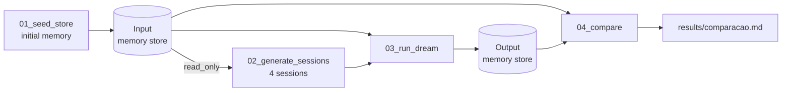

# Claude Managed Agents — Dreaming in practice

🇧🇷 [Português](README.md) | 🇺🇸 English

A hands-on study of **Dreams**, a research-preview feature of Anthropic's Claude Managed Agents. A dream reads a memory store together with past session transcripts and produces a **new, reorganized memory store**: it merges duplicates, replaces stale facts with the latest value and surfaces buried details. The input store is never modified.

This repository builds a controlled scenario around a fictional project (`kizomba-api`) and checks against an answer key whether the dream actually fixes the memory.

> ⚠️ **Synthetic data only.** During the research preview, Dreams is not eligible for ZDR or HIPAA, and sessions are stored until deleted. Do not use real company or customer data.

> The scenario files (conversations, questions, memory) are in Brazilian Portuguese, which is the point of the study: it also shows how Dreams behaves with non-English content.

## The scenario

Memory starts **deliberately outdated** (`data/memoria_inicial.md`). Four conversations bring in new information:

| Conversation | What it tests |
|---|---|
| `01-onboarding` | A new preference (docstrings, ruff) and an updated rule (type hints on every function) |
| `02-bug-fuso-horario` | A buried detail (`KIZOMBA_TZ`), debug noise and a duplicate |
| `03-migracao-python` | Contradiction: Python 3.11 → 3.12, `pytest -x` → `uv run pytest -q`, Heroku → Fly.io |
| `04-release-0-4-0` | Contradiction on the branch flow and a new fact (CHANGELOG) |

The expected result is in [`data/gabarito.md`](data/gabarito.md) (bilingual).

## How it works



Sessions mount the memory `read_only`: the agent reads the old facts but cannot fix them. The dream does.

## Layout

```
claude-dreaming-study/
├── README.md / README.en.md
├── .env.example            # copy to .env
├── requirements.txt
├── src/
│   ├── common.py               # client, state, session helpers
│   ├── 01_seed_store.py        # environment, agent, memory store + initial memory
│   ├── 02_generate_sessions.py # runs each script in data/conversas
│   ├── 03_run_dream.py         # creates and follows the dream
│   ├── 04_compare.py           # before × after
│   └── 99_cleanup.py           # removes everything from your account
├── data/
│   ├── memoria_inicial.md      # initial memory
│   ├── conversas/*.md          # 1 file = 1 session; messages split by ---
│   ├── dream_instructions.md
│   ├── perguntas.md            # questions
│   └── gabarito.md             # answer key
└── results/                    # transcripts, dream.json, comparacao.md
```

## Requirements

- Python 3.11+
- An Anthropic API key with access to the Managed Agents beta and Dreams
- The SDK sets each call's beta header (`dreaming-2026-04-21` for dreams)

## Running it

```bash
git clone https://github.com/mlussati/claude-dreaming-study.git
cd claude-dreaming-study
python -m venv .venv && source .venv/bin/activate
pip install -r requirements.txt
cp .env.example .env   # fill in ANTHROPIC_API_KEY

python src/01_seed_store.py        # creates resources and writes the initial memory
python src/02_generate_sessions.py # runs the 4 conversations
python src/03_run_dream.py         # creates the dream and waits for it
python src/04_compare.py           # writes results/comparacao.md
python src/99_cleanup.py           # removes everything (or --keep-output)
```

Each script stores IDs in `state.json` (git-ignored), so steps can be re-run without duplicating resources. `03_run_dream.py` can be stopped with Ctrl+C and resumed; pass `--cancel` to cancel the dream.

## Results

> Fill in after running.

| Answer-key item | Before | After |
|---|---|---|
| Python and tests | | |
| Deploy | | |
| `KIZOMBA_TZ` | | |
| Conventions | | |
| Branches | | |
| Noise dropped | | |

- Dream duration:
- Tokens (`results/dream.json`):
- Estimated cost:

## Learnings

> Your notes: what worked, what surprised you, effect of `instructions`, limits.

## Known limitations

- Dreams takes 1 to 100 sessions per run and supports only some models.
- Don't delete the input store or sessions while the dream is `pending` or `running`.
- `instructions` steers synthesis at a high level. It does not edit specific lines.
- Check the session event format (`agent.message`) and the cleanup methods for sessions/agents/environments against the docs; see comments in `src/common.py` and `src/99_cleanup.py`.

## Next steps

- Run the *Dreaming with a dynamic workflow* cookbook and compare it with the managed API.
- Try more sessions and measure how cost grows.
- Vary `dream_instructions.md` and compare the outputs.

## References

- [Dreams — documentation](https://platform.claude.com/docs/en/managed-agents/dreams)
- [Cookbook: Dreaming with a dynamic workflow](https://platform.claude.com/cookbook/managed-agents-cma-dreaming-with-a-dynamic-workflow)

## License

MIT — see [LICENSE](LICENSE).
