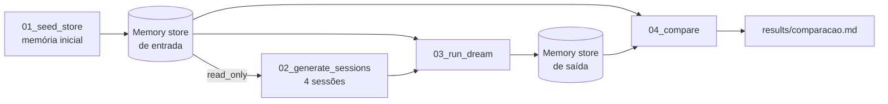

# Claude Managed Agents — Dreaming na prática

🇧🇷 Português | 🇺🇸 [English](README.en.md)

Estudo prático do **Dreams**, recurso em *research preview* dos Claude Managed Agents da Anthropic. Um dream lê um memory store junto com transcrições de sessões passadas e gera um **memory store novo e reorganizado**: junta duplicatas, troca fatos desatualizados pelo valor mais recente e traz à tona o que estava enterrado. O store de entrada nunca é alterado.

Este repositório monta um cenário controlado com um projeto fictício (`kizomba-api`) e mede, com gabarito, se o dream de fato corrige a memória.

> ⚠️ **Só dados sintéticos.** Durante o research preview, o Dreams não é elegível para ZDR nem HIPAA, e as sessões ficam armazenadas até serem apagadas. Não use dados reais de empresa ou de clientes.

## O cenário

A memória começa **propositalmente desatualizada** (`data/memoria_inicial.md`). Quatro conversas trazem informações novas:

| Conversa | O que testa |
|---|---|
| `01-onboarding` | Preferência nova (docstrings, ruff) e regra atualizada (type hints em todas as funções) |
| `02-bug-fuso-horario` | Detalhe enterrado (`KIZOMBA_TZ`), ruído de debug e duplicata |
| `03-migracao-python` | Contradição: Python 3.11 → 3.12, `pytest -x` → `uv run pytest -q`, Heroku → Fly.io |
| `04-release-0-4-0` | Contradição no fluxo de branches e fato novo (CHANGELOG) |

O resultado esperado está em [`data/gabarito.md`](data/gabarito.md).

## Como funciona



Nas sessões, a memória é montada como `read_only`: o agente lê os fatos antigos, mas não consegue corrigi-los. Quem corrige é o dream.

## Estrutura

```
claude-dreaming-study/
├── README.md / README.en.md
├── .env.example            # copie para .env
├── requirements.txt
├── src/
│   ├── common.py               # cliente, estado, helpers de sessão
│   ├── 01_seed_store.py        # ambiente, agente, memory store + memória inicial
│   ├── 02_generate_sessions.py # roda cada roteiro de data/conversas
│   ├── 03_run_dream.py         # cria e acompanha o dream
│   ├── 04_compare.py           # antes × depois
│   └── 99_cleanup.py           # apaga tudo da sua conta
├── data/
│   ├── memoria_inicial.md
│   ├── conversas/*.md          # 1 arquivo = 1 sessão; mensagens separadas por ---
│   ├── dream_instructions.md
│   ├── perguntas.md
│   └── gabarito.md
└── results/                    # transcrições, dream.json, comparacao.md
```

## Pré-requisitos

- Python 3.11+
- Chave da API Anthropic com acesso ao beta de Managed Agents e ao Dreams
- O SDK define os headers beta de cada chamada (`dreaming-2026-04-21` para dreams)

## Como rodar

```bash
git clone https://github.com/mlussati/claude-dreaming-study.git
cd claude-dreaming-study
python -m venv .venv && source .venv/bin/activate
pip install -r requirements.txt
cp .env.example .env   # preencha ANTHROPIC_API_KEY

python src/01_seed_store.py        # cria recursos e grava a memória inicial
python src/02_generate_sessions.py # roda as 4 conversas
python src/03_run_dream.py         # cria o dream e espera terminar
python src/04_compare.py           # gera results/comparacao.md
python src/99_cleanup.py           # limpa tudo (ou --keep-output)
```

Cada script salva os IDs em `state.json` (ignorado pelo git), então dá para rodar de novo sem duplicar recursos. O `03_run_dream.py` pode ser interrompido com Ctrl+C e retomado; use `--cancel` para cancelar o dream.

## Resultados

> Preencha depois de rodar.

| Item do gabarito | Antes | Depois |
|---|---|---|
| Python e testes | | |
| Deploy | | |
| `KIZOMBA_TZ` | | |
| Convenções | | |
| Branches | | |
| Ruído descartado | | |

- Tempo do dream:
- Tokens (`results/dream.json`):
- Custo estimado:

## Aprendizados

> Seus registros: o que funcionou, o que surpreendeu, efeito do `instructions`, limites.

## Limitações conhecidas

- Dreams aceita de 1 a 100 sessões por execução e só alguns modelos.
- Não apague o store nem as sessões de entrada enquanto o dream estiver `pending` ou `running`.
- O `instructions` orienta a síntese de forma geral. Não serve para editar linhas específicas.
- O formato dos eventos de sessão (`agent.message`) e os métodos de limpeza de sessions/agents/environments devem ser conferidos na documentação; ver comentários em `src/common.py` e `src/99_cleanup.py`.

## Próximos passos

- Rodar o cookbook *Dreaming with a dynamic workflow* e comparar com a API gerenciada.
- Testar com mais sessões e medir como o custo cresce.
- Variar o `dream_instructions.md` e comparar as saídas.

## Referências

- [Dreams — documentação](https://platform.claude.com/docs/en/managed-agents/dreams)
- [Cookbook: Dreaming with a dynamic workflow](https://platform.claude.com/cookbook/managed-agents-cma-dreaming-with-a-dynamic-workflow)

## Licença

MIT — veja [LICENSE](LICENSE).
